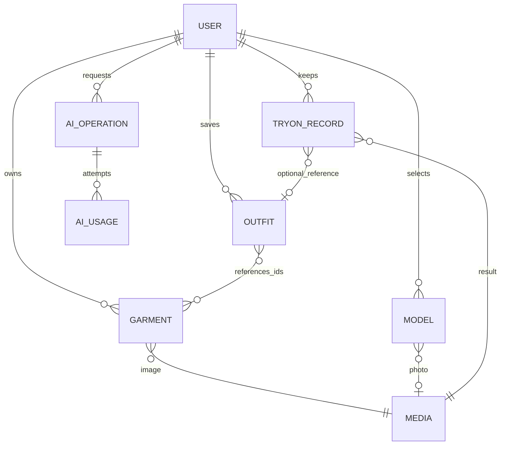

# 数据库与数据字典

更新：2026-11-21。来源：[database.js](../../server/database.js)、[state.js](../../server/state.js)。**已有表不代表对应功能已接入。**

## 存储布局

```text
DATA_DIR/                       默认 server/data，生产须持久化
  yixianzhi.sqlite              元数据、快照、任务、费用
  yixianzhi.sqlite-wal / -shm   SQLite 工作文件，运行时可能存在
  media/<账号SHA256>/<图片SHA256>  私有图片字节，无公开静态 URL
```

启用 WAL、外键检查、5 秒 busy timeout。`transaction()` 使用 `BEGIN IMMEDIATE`；应用按单进程设计，不能跨 await 持有同步事务。备份运行中的数据库不能仅复制主 sqlite 文件，必须使用一致快照或停服复制完整数据目录。

## 现行表

| 表 | 主键与主要字段 | 运行用途 |
|---|---|---|
| `users` | email PK；created_at、last_login_at | 当前账号身份；ensureUser 也会刷新 last_login_at，尚非严格登录审计 |
| `user_state` | email PK/FK users；version、state、updated_at | 当前整账号 JSON 快照；媒体用引用替换 |
| `media` | (owner,id) PK；owner FK users；mime、size、path | 图片归属和文件索引，size 为字节 |
| `kv` | key PK；value JSON、expires_at | 验证码、限流、任务和幂等记录；0 表示无过期 |
| `events` | id PK；ts、event、email、props | 当前埋点与后台统计；时间索引 events_time |

`user_state` 当前业务字段：`dataVersion`、`customItems`、`customOutfits`、`models`、`history`、`favorites`、`wardrobe`、`deletedItems`、`profile`、`account`、`curModel`、`onboarded`、`privacyOk`、`historySeeded`、`processedSegmentTargets`。账号同步只保留 nick/avatar；pendingSegments、outfitDraft 和登录令牌不在同步白名单。

## v2/v3 表结构升级已创建的表

SQLite 当前 `PRAGMA user_version=3`；客户端同步仍是 v1。

| 表 | 主键与字段摘要 | 接入状态 |
|---|---|---|
| `consents` | (owner,purpose)；version、granted、updated_at；owner FK users | 函数已写，授权 API/UI 未接入 |
| `ai_operations` | id；owner FK、kind、fingerprint、status、result、error、created_at、updated_at、cycle | 拆图部分使用，其他 AI 路由待统一 |
| `ai_usage` | id；operation_id、owner、provider、model、budget_day、reserved、status、usage、started_at、finished_at | 网关已写，真实链路未完整验收 |
| `entities` | (owner,kind,id)；data、version、deleted | 增量实体表，待接入 |
| `changes` | cursor INTEGER AUTOINCREMENT；owner、kind、id、version、data、deleted | 有序变更日志，待接入 |
| `sync_migrations` | owner；source_version、migrated_at | 一次性快照迁移标记，待接入 |
| `mutations` | (owner,id)；request_hash、result | 推送幂等回执，待接入 |
| `media_age` | (owner,id)；created_at | 媒体宽限，当前媒体服务函数内部使用 |
| `accounts` | email；generation、active | 升级到数据库版本 3 时从 users 一次性补行；后续启动/注册不自动补行，注销隔离未接入 |
| `sessions` | hash；email、generation、expires_at | 可撤销会话预留，当前 auth 未使用 |
| `operation_inputs` | id；data、expires_at | AI 输入保留预留，尚未写入完整流程 |

`ai_operations` 有 `(owner,kind,fingerprint)` 唯一约束和 `(owner,created_at)` 索引；`ai_usage` 有 `(budget_day,owner)` 索引；`changes` 有 `(owner,cursor)` 索引。entities 等新增表尚未声明外键，归属与生命周期规则必须由待接入服务检查；不可把逻辑关系写成数据库已强制的约束。

## 逻辑关系（包含目标模型）



GARMENT/OUTFIT 等是业务实体名称，目前主要存在快照 JSON 中，不是已建同名关系表。衣物删除不级联删除搭配或历史图片；搭配中的失效 ID 用于提示缺失。v2 通过实体墓碑防止旧设备恢复已删除数据。

## 媒体、时间与费用约定

- media.id 为图片原始字节 SHA-256，不是 URL 哈希；读写始终校验 owner。
- `users`、`user_state`、`events.ts` 使用 ISO 时间字符串；新增任务/授权表使用毫秒时间戳，API 转换要明确。
- `budget_day` 是 UTC 日期；`reserved` 为整数 micro USD，不能使用浮点金额。
- 模型密钥放环境配置；验证码存 HMAC 摘要；当前客户端 token 存本机账号状态，不写入云端快照或导出。

## 升级与运维约束

表结构迁移在事务内执行，遇到比代码更新的 user_version 会拒绝启动。生产升级前备份数据库和媒体并在副本验证迁移；不降低版本号以强行运行旧代码。

当前 v1 未提供完整账号注销、媒体回收与任务留存清理。v2 迁移和删除顺序见 [M4](../modules/m4-sync.md)，不能通过手工清空个别表替代。
