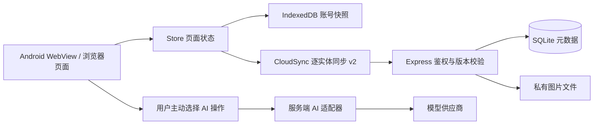

# 技术栈与架构

更新：2026-11-22。描述当前代码；尚未接入的改造单独标注。

## 技术选择

| 层 | 当前选择 | 边界 |
|---|---|---|
| 页面 | HTML、CSS、原生 JavaScript，多页面 | 沿用现有交互，不引入 Vue/React |
| Android | Capacitor 8.6.2；App 插件 8.1.2 | 本地网页资源运行于 WebView |
| 服务 | Node.js 24、Express 4 | 一个进程、一份数据卷 |
| 数据 | Node 内置 SQLite，WAL | 事务和版本检查；不是多实例数据库 |
| 图片 | 私有文件目录、sharp 0.35.5 解码校验 | SQLite 保存归属、哈希、路径和大小 |
| 本机 | IndexedDB 快照与 Blob | 按服务地址和账号隔离；图片按哈希缓存 |
| AI | 本地 INSPECT/CUTOUT/TRYON adapter；OpenRouter 推荐、旧 DashScope 兼容 | 密钥仅在服务器；操作、授权与逐次预算网关已接入 |
| 验证 | node:test、Playwright、APK 校验脚本 | 使用临时数据与模型替身 |

准确依赖版本以 [package.json](../../package.json) 和锁文件为准。模型名集中在 [config.js](../../server/ai/config.js)，这里只记录配置位置，不承诺第三方模型持续可用或固定价格。

## 当前数据链路

手动添加衣物：相册/相机 → 本机压缩 → 编辑名称、类别、场景、归属 → 保存快照 → 在线时推送账号状态。保存完整照片的压缩版 originalImage；可选 cutoutImage 是独立派生图，不覆盖该原图。

云端同步：图片按哈希单独上传 → 实体携带 media: 引用和 expectedVersion → 服务端事务提交实体、变更标识和幂等回执。拉取仅传实体元数据；可见图片按需下载到账号 Blob 缓存。

照片检查、去背景、推荐和试穿统一使用持久操作及预算网关。已完成图片先落盘，再在事务中提交记录和完成状态；重开页面查询原任务。测试使用供应商替身，真实模型及邮件配置由部署者填写后联调。

## 代码地图

| 位置 | 职责 |
|---|---|
| 根目录产品 HTML | 页面骨架与页面脚本清单 |
| `css/`、`assets/` | 样式、字体、图标、示例图片 |
| `js/bootstrap.js` | 先打开本机数据，再顺序加载共享和页面脚本 |
| `js/app.js`、`product.js` | 状态默认值、公共组件、搭配保存和收藏 |
| `js/persistence.js` | IndexedDB、写入队列、导航前保存、备份 |
| `js/runtime.js`、`sync.js`、`ai.js` | 服务连接、认证请求、同步、AI 调用 |
| `js/pages/` | 各页面业务交互 |
| `server/server.js` | 路由、鉴权、请求大小、静态发布边界 |
| `server/database.js`、`state.js` | 建表/升级、兼容快照与字段校验 |
| `server/ai-control.js`、`actions.js`、`media.js` | 费用预留、用户动作幂等和独立媒体服务 |
| `server/jobs.js`、`ai/` | 拆图任务和供应商适配 |
| `android/` | 原生容器、文件导出插件、Android 资源 |
| `scripts/`、`tests/` | 构建、流程验证、接口测试 |

## 数据与发布边界

当前已接入逐实体同步、独立图片上传和 Blob 缓存。变更日志保存标识，分页读取完整最新实体及其版本；并发新版本在下一轮允许重复拉取，客户端按版本去重。详见 [M4](../modules/m4-sync.md) 和 [数据库契约](../contracts/database.md)。

`www/` 是生成目录，服务端只公开该目录。SQLite、密钥、参考仓库、文档和测试均不得进入 APK 的网页资源包。
