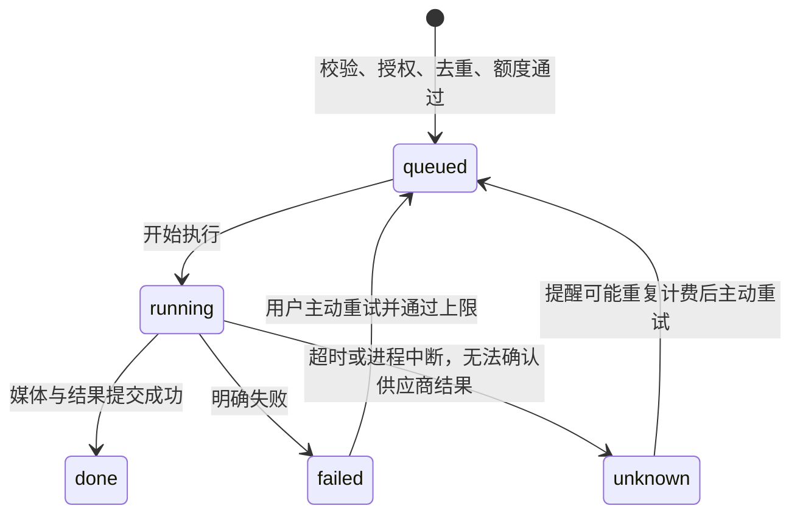

# M3 AI 任务与成本

状态：设计有条件通过；`ai-control.js` 和相关表已编写，路由、前端授权、结果实体和重试收尾尚未统一接入。当前不能按生产 AI 服务验收。

## 触发规则

| 操作 | 输入 | 输出 | 触发条件 |
|---|---|---|---|
| 衣物整理 | 一张用户照片 | 识别目标、平铺图片、衣物标签 | 衣物预览中主动确认 |
| 搭配推荐 | 当前衣橱与可选锚点 around；个人 profile/pref 尚未传入 | 本次候选中的衣物 ID 组合 | 点击 AI 推荐 |
| 生成试穿 | 模特照片、1～4 件衣物 | 试穿图和对应记录 | 点击生成；不与推荐绑定 |
| 照片质检 | 用户照片 | 通过与原因 | 当前页面不再自动调用；旧接口保留 |

未配置模型时，手动管理仍可用。线上错误不能静默替换成演示图；只有明确选择的本地演示允许合成。

## 目标任务生命周期

相同账号、功能、规范化输入、模型及提示词版本形成指纹。相同执行中的请求返回原 operationId；已完成结果复用。刷新、轮询、重开页面不得产生新付费请求。

输入保存为有归属的媒体引用并保留 7 天；结果先写入长期业务实体。恢复已完成记录不依赖临时任务缓存。重试需稳定操作 ID、cycle 条件更新、冷却时间及累计尝试上限；成功的拆图子结果不得重复生成。

## 成本控制设计

次数配额限制用户操作；预算预留限制每次实际供应商请求。识别、逐件生图、标签、备用模型分别是供应商尝试，都必须经过同一网关。

费用使用整数 micro USD（1 美元 = 1,000,000 单位）。事务内先检查用户/全站当日预算、并发和操作累计上限，再预留金额，之后才发请求。UTC 日期作为预算日。失败或未知结果保留预留，避免无法确认账单时超支。

| 网关配置 | 当前代码默认含义 |
|---|---|
| `AI_GLOBAL_DAILY_MICRO_USD` / `AI_USER_DAILY_MICRO_USD` | 缺失或 0 时关闭真实供应商调用 |
| `AI_MAX_OPENROUTER_MICRO_USD` / `AI_MAX_DASHSCOPE_MICRO_USD` | 每次尝试的保守预留上限；缺失/0 时关闭 |
| `AI_MAX_OPERATIONS` | 全站同时排队/执行操作，默认 12 |
| `AI_MAX_CONCURRENCY` | 供应商并发，默认 6 |
| `AI_MAX_ATTEMPTS_PER_OPERATION` | 操作累计最多 16 次尝试 |
| `AI_MAX_OPERATION_MICRO_USD` | 操作累计预留默认 1,000,000 |

这些是已编写网关的配置，不是现有部署已生效的保证，`.env.example` 尚未完整列入。旧路由 `charge` 将次数 0 解释为不限额，新网关将 0 解释为禁用；上线前必须统一为“0 禁用”，禁止混用两套扣费入口。

内部预留上限不是供应商实际价格，也不是账单退款。部署者需根据实际模型配置保守上限，并设置供应商账户额度。

## 必须完成的接入项

- 所有 AI 路由统一创建操作上下文。适配器已调用 providerFetch，但直接试穿、推荐、质检等路由尚未建立 operation 上下文，会被网关拒绝；仅填入密钥仍不能正常完成这些真实调用。
- 服务端授权接口与前端确认/撤回；每次重试或备用调用重新校验。
- 输出图片验证大小与格式，限制下载大小和时长，先持久化再返回成功。
- 稳定结果实体、删除墓碑、七天输入保留和过期 410。
- cycle 防旧回调覆盖；账号冻结/generation 防注销后写回。
- 修正失败拆图子任务的重试收尾及客户端 30 分钟放弃逻辑。

验收使用可控制的供应商替身：重复提交、并发抢最后预算、无效输入不扣费、跨日重试、撤回后备用调用、进程中断、输出落盘失败、成功子项复用。真实付费调用不是默认测试步骤。

实现：[ai-control.js](../../server/ai-control.js)、[jobs.js](../../server/jobs.js)、[server.js](../../server/server.js)、[ai.js](../../js/ai.js)。
